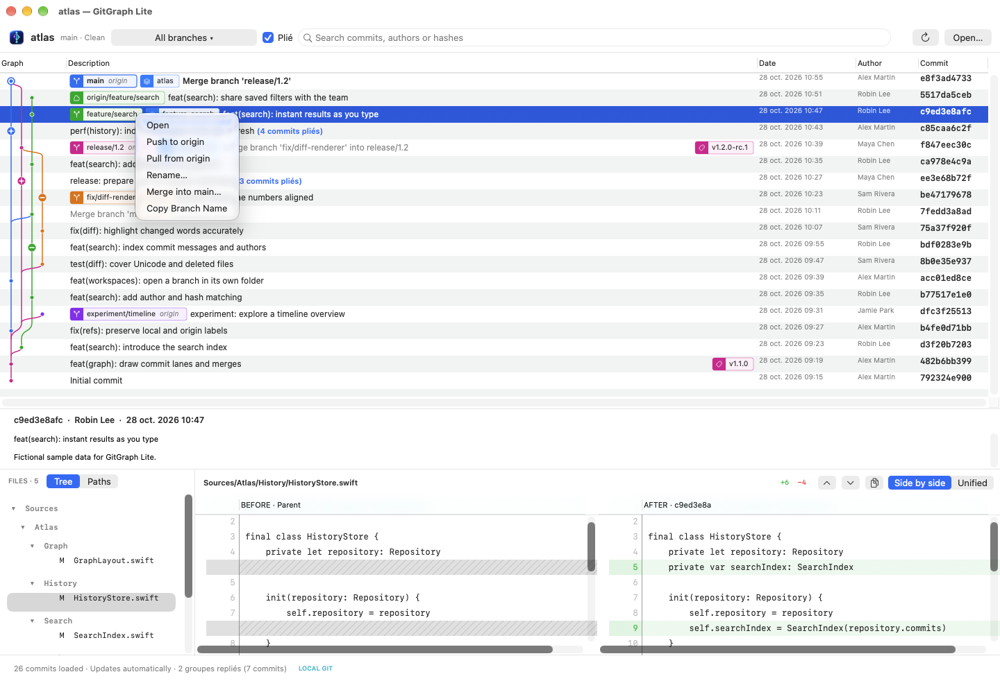
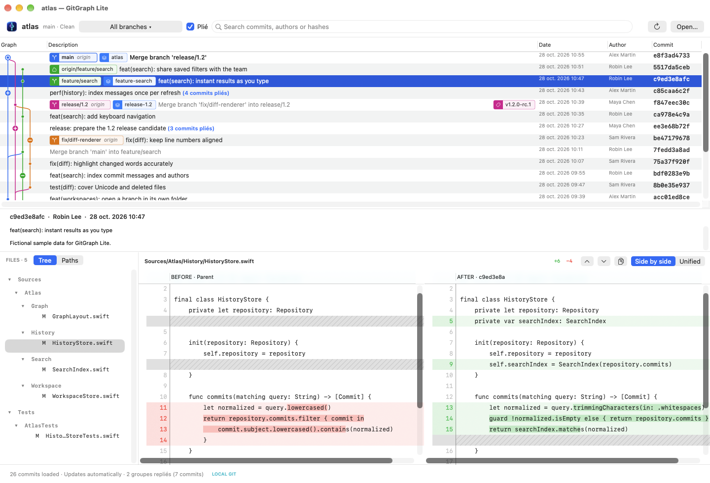
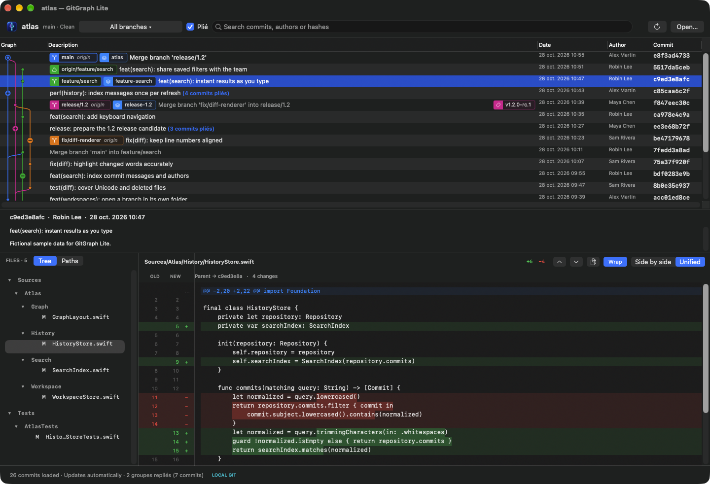
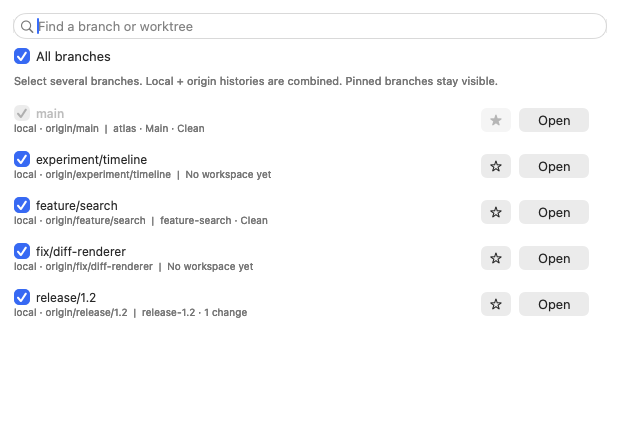
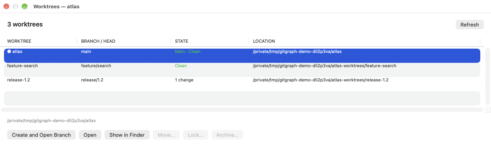

  
  <h1>GitGraph Lite</h1>
  
<strong>See the whole history. Stay on the right branch.</strong>

  
A focused, native macOS Git browser with a colourful graph, visual diffs and a dedicated workspace for every branch you open.

  

    <a href="https://github.com/zapaz/gitgraph-lite/releases/latest"><strong>Download for macOS</strong></a>
    &nbsp;·&nbsp; <a href="docs/guide.md">User guide</a>
    &nbsp;·&nbsp; <a href="HISTORY.md">Release history</a>
  

  
macOS 13+ · Apple Silicon · Native AppKit · MIT licensed

A real app capture with the fictional Atlas sample repository. Click any image to view it full size.

## Your history, without the clutter

- **Follow every branch.** Trace merges across a coloured graph. See local branches, origin refs, tags and worktrees in context.
- **Keep each workspace on its branch.** Open a branch to reuse its dedicated worktree—or create one automatically. Your other workspace keeps its branch and local changes.
- **Understand the change.** Inspect side-by-side or unified diffs with line numbers and word highlights. Browse changed files as a folder tree, or compare two commits with ⌘-click.
- **Act on exactly what you click.** Short menus for commits, branches, tags and worktrees. Push one branch, publish one tag, or pull into the selected branch's workspace with fast-forward protection.
- **Make room for what matters.** Filter several branches, pin the important ones and fold long commit chains. The graph refreshes after changes made in your other Git tools.

## Take a closer look

  
  
  
  

Side-by-side diffs · Unified in dark mode · Branches &amp; pins · Dedicated workspaces

## Get started

1. **[Download the latest release](https://github.com/zapaz/gitgraph-lite/releases/latest)** for Apple Silicon.
2. Unzip it and drag **GitGraph Lite.app** into **Applications**.
3. Open a local repository with **⌘O**. Follow its history, inspect a change or open a branch's workspace.

**⌘F** searches loaded commits · **⌘R** refreshes · **⌘-click two commits** compares them.

The app uses your installed `/usr/bin/git` and existing Git/SSH credentials. Preferences and action rankings stay on your Mac. No account is required; there is no cloud sync or telemetry. The downloadable app is locally signed and is not notarized by Apple.

## Small app. Real Git.

Inspired by the compact workflow of VS Code's Git Graph, built independently with Swift and AppKit. No extension code or assets are reused. GitGraph Lite focuses on history, diffs and branch/worktree navigation, alongside your editor and other Git tools.

[User & developer guide](docs/guide.md) · [Performance measurements](docs/performance-0.10.7.md) · [All versions & downloads](HISTORY.md) · [Build from source](docs/guide.md#build-and-test) · [MIT License](LICENSE)
