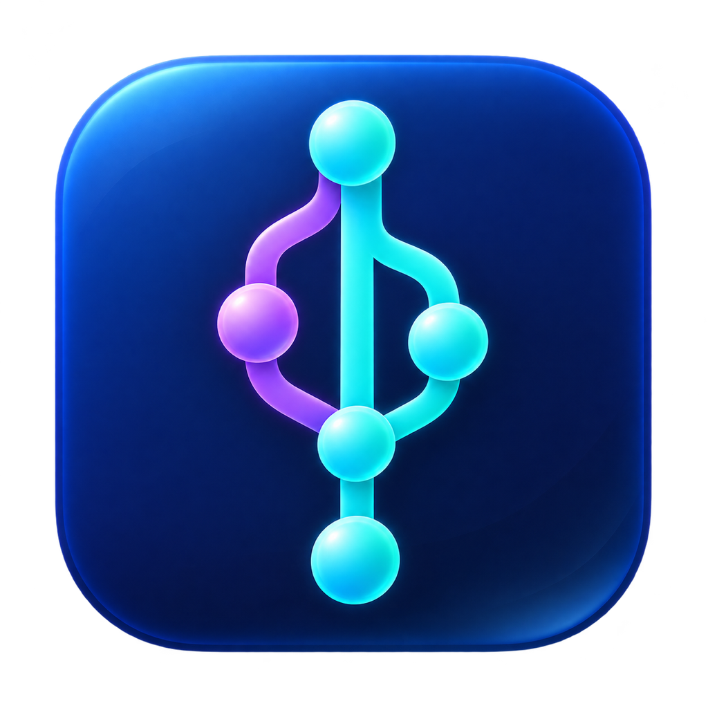

# GitGraph Lite



A small native macOS Git history browser, inspired by the compact workflow of VS Code's Git Graph. This is an independent implementation, with no extension source code or assets reused.

## Download

**[Latest release](https://github.com/zapaz/gitgraph-lite/releases/latest)** · [Download 0.10.4 for Apple Silicon](https://github.com/zapaz/gitgraph-lite/releases/download/v0.10.4/GitGraph-Lite-0.10.4-macOS-arm64.zip) · [All releases](https://github.com/zapaz/gitgraph-lite/releases)

Requires macOS 13 or later and Apple Silicon (M1 or newer). Unzip and drag **GitGraph Lite.app** into **Applications**. Each release includes a ZIP, the MIT license notice and a SHA-256 checksum file. The app is not notarized by Apple.

Historical downloads cover **0.1.0 through 0.10.4**. Version 0.2.0 is a preserved binary-only release: its tag contains archival metadata because the exact intermediate source snapshot was not retained.

## Run

Open the prebuilt **GitGraph Lite.app**, or build it from source with the commands below. Then choose **Open Repository…** (⌘O).

- Coloured commit graph with branch and tag labels.
- Compact 24px history rows with a stronger blue/magenta/green/orange graph palette. Branch badges use the matching lane colour, a coloured icon and an individually outlined label; matching local/remote refs share a badge. Tags appear separately at the right of the description. Full ref names and worktree paths remain available in the row tooltip.
- Current worktree HEAD has a ring in the graph and a stronger description/branch label. Worktree occupancy is shown with a small stack marker rather than several long name badges.
- History uses Git's date order so recent commits on parallel branches stay near each other while children remain above their parents. Dates show the committer timestamp in local time, including hours/minutes.
- Commit message, author, date, and file changes.
- Select a file for a side-by-side diff with aligned lines, old/new line numbers, line backgrounds and highlighted changed text.
- Scroll each side horizontally; vertical scrolling stays synchronized. Use the arrow buttons to jump between changes, or switch to **Unified** to copy a patch.
- Unified view has fixed OLD/NEW line-number gutters and change markers, full-width addition/deletion backgrounds, word highlights, hunk separators and optional line wrapping. Next/previous change stays in the selected mode and shows a change counter. Text remains selectable; **Copy patch** copies Git's original patch, including its metadata and prefixes (disabled for truncated previews).
- ⌘-click exactly two commits to compare the older selected commit to the newer one in the displayed history.
- Branch filtering and search across loaded commit messages, authors, hashes and labels.
- Loads 500 commits initially; **Load more** adds another 500.
- Checks refs and HEAD every four seconds and refreshes after external commits, branch changes and tags.
- Remembers the last repository/worktree.
- ⌘R refreshes, ⌘F searches, ⇧⌘C copies selected commit hashes.
- Terminal: `open -a "/path/to/GitGraph Lite.app" --args --repo "/path/to/repository"`.

## Branch browser and compact history (version 0.8)

The header uses a single compact row for the repository, active branch/state, branch browser, fold checkbox, search, refresh and open controls. The full repository path is available in the repository tooltip.

- The HISTORY picker supports multiple branches. A branch name includes its local and origin references, even when their tips diverge. Filtering never checks out a branch.
- `main` and `master`, when present, are always pinned and included in filtered history. Star other branches to keep them visible too. Pins persist per repository and are shared between its worktrees. Pinning controls history visibility, not Git write permissions.
- Each branch shows its local/remote versions and workspace state. **Open** reuses its dedicated worktree or creates it on demand. Remote-only branches also offer **Create local**, which creates the tracking branch without a folder.
- Folding follows each complete loaded linear chain through its oldest commit, including the root when it has no protected ref or junction. There is no arbitrary 20-commit cutoff. Group boundaries stay stable when selecting commits, and hidden selections are cleared when collapsing. One global checkbox controls folding: checked **Plié** keeps the newest real commit and appends **(N commits pliés)** after its description, counting only the older commits hidden. Its hash, author, date, refs, selection and context actions remain available. The count is reserved display space so long descriptions cannot hide it. Folded commits use the three-small-lines marker in the lane’s color; ordinary graph connections stay unchanged. A chain that would hide only one commit is never folded. Click either the marker or the trailing count to unfold just that chain; neighbouring chains stay folded. These temporary expansions reset when the global checkbox is changed or another workspace/repository is opened. Unchecked **Déplié** displays every commit directly and removes the annotation entirely, with no intermediate headers. The global checkbox remains available alongside the click-to-unfold shortcuts; there is no persistent per-branch setting. The global setting persists across launches. Branch/tag tips, worktree HEADs, merge commits and junctions remain visible. Groups follow Git parent links even when other branches are interleaved in date order. The visible graph is rebuilt around the folded nodes so connections remain correct. The footer reports the folded group and commit counts. Searching temporarily shows individual commits.
- The context menu shows the five most-clicked available actions; the rest appear under **Plus…**, also sorted by use. Counts persist locally on this Mac across repositories and app restarts, using stable action identifiers. No cloud sync or telemetry is used. A fresh computer/profile starts at zero. Equal counts use a fixed default order. Branch/tag actions with several targets share one ranked slot and offer an explicit target submenu. Choosing an action counts once, even if its subsequent dialog is cancelled; merely opening menus does not count.
- Changed files default to a collapsible **Tree** view; **Paths** restores the full-path list. File mode persists across launches.
- Commit hashes use ten characters and stronger monospace text; date and author use smaller secondary text.

## Branches and dedicated workspaces (version 0.10)

The model is scoped to one local repository/clone. Each window displays one repository's graph. Independent clones have independent branch/workspace associations, even when their branch names match.

- A local branch has **zero or one worktree**. **Create Local Branch** creates only the ref, with an automatic unique name. It does not create a folder or change HEAD.
- **Open Branch…** creates the branch's worktree on first use or opens the existing one. The worktree remains dedicated to that branch. The app never switches an existing worktree to another branch.
- **Create and Open Branch Here…** creates a local branch at the chosen commit and immediately opens its dedicated workspace. Names and folders are automatic, with no form or location chooser.
- Remote branches remain independent of worktrees. Viewing, filtering or comparing them creates nothing. **Create local** makes a same-named local tracking branch without a folder. **Open** then opens/creates that local branch's dedicated workspace.
- Existing local commits are preserved. Existing upstreams are checked and never replaced silently. If `main` tracks another remote, opening `origin/main` reports the mismatch instead of changing tracking or resetting commits.
- Dirty files in the current workspace stay untouched when opening another branch. Its existing workspace is reused even if it has local changes or a pending operation.
- Folders are placed beside the main checkout in `<repository>-worktrees/`, with collision-safe names. Existing folders and branches are never overwritten.
- **Archive…** removes a clean, inactive linked worktree while keeping its branch. Opening that branch later recreates a workspace. Main, dirty, missing, locked and active worktrees remain protected.
- Existing worktrees are adopted in their current state. Association records live in `gitgraph-lite-workspaces.json` inside the repository's common Git directory, guarded by a process lock. They are local metadata, never tracked or pushed. Worktree identity follows Git's administration directory, so moving the folder does not change its assigned branch.
- External branch switches or forced duplicate worktrees are flagged; editing/navigation to the inconsistent association is blocked rather than silently reassigning it. Restore the expected association with your external Git tool, or archive the inactive workspace. Temporary detached HEADs during a rebase of the assigned branch remain supported. External detached worktrees can be inspected, but new workspaces created by the app always use a local branch.
- The branch checkboxes filter history only; they never create a local branch, worktree or folder. Right-clicking a branch badge targets that ref. A generic row **Open Branch…** prefers an existing local branch, then `origin`, then a stable lexical ordering.

## Commit context menu

History operations retain the legacy Git Graph names; navigation uses Open/Create terminology. The five most-used actions appear directly; the rest are under **Plus…**. The available actions include:

```text
Add Tag...
Create Local Branch
Create and Open Branch Here…
────────────────────────────────────────────
Open Branch…
Cherry Pick...
Revert...
────────────────────────────────────────────
Merge into current branch...
Rebase current branch on this Commit...
Reset current branch to this Commit...
────────────────────────────────────────────
Copy Commit Hash to Clipboard
Copy Commit Subject to Clipboard
```

Reset opens a dialog offering soft/mixed/hard modes. Opening either a local or remote branch uses its dedicated workspace and never changes the current folder’s branch. A commit with no branch gets a new automatically named branch/workspace when explicitly opened.

All actions, including comparison, full-message copy, drop, branch/tag management and conflict recovery, participate in the local usage ranking. The top five appear directly and the rest are under **Plus…**. Manual action pins have been replaced by this automatic ordering. Disabled actions cannot be invoked or counted.

The menus support:

- Copy its hash or full commit message.
- Compare with HEAD, select a comparison anchor, or compare two selected commits.
- Create a worktree from the commit, or add a lightweight or annotated tag.
- Cherry-pick, revert, merge, rebase the current branch, reset (soft/mixed/hard), or drop an ordinary commit from the current branch's history.
- Choose the mainline parent when cherry-picking or reverting a merge commit.
- Choose fast-forward, merge-commit or squash mode when merging. Squash stages changes without committing.
- Use branch submenus to open/create a worktree, copy the branch name, or rename/safely delete an unused branch; tag submenus can copy/delete a tag.
- Continue or abort a pending merge, rebase, cherry-pick or revert after resolving conflicts in your editor and staging the files.

Mutation dialogs describe the target and effect. Merge, cherry-pick, revert, rebase and drop require a clean working tree. Rebase, reset and drop create a local `gitgraph-backup/...` branch pointing to the previous HEAD. These backups preserve committed history, **not uncommitted changes**. Hard reset explicitly discards local changes after confirmation. Branch deletion uses Git's safe `-d` mode. The app rejects an action if refs, HEAD or the pending operation changed while its dialog was open.

## Worktree management

- Use the branch browser’s **Open** button to navigate between dedicated workspaces. The redundant standalone worktree selector has been removed. Active worktree state appears beside the repository path.
- **File → Manage Worktrees…** lists every worktree's path, branch or detached HEAD, changed-file count, main/locked/missing/prunable state.
- Create and open a worktree on an automatically named new branch, or reuse an existing local branch, without supplying a name or location. Existing detached worktrees remain supported for browsing and management.
- **Create and Open Branch Here…** starts a new branch and dedicated workspace from that commit.
- Move a clean linked worktree, lock/unlock it, or remove it while preserving its branch. Removing a detached worktree first saves its HEAD to a `gitgraph-backup/worktree-...` branch.
- Removal refuses main, active, locked, missing or dirty worktrees, pending operations, and any case rejected by Git. No force removal is offered.
- Branches assigned to a worktree cannot be renamed/deleted here. External duplicate assignments are reported; the app never forces a branch into two worktrees.
- The graph marks worktree HEADs with blue badges and includes commits reachable only from detached worktree HEADs when showing all branches.
- The main window refreshes worktree state automatically; the manager also has a Refresh button. Stale/missing registrations are shown, but pruning and repair remain CLI operations.

## Scope

Version 0.10 adds local branches with lazy dedicated workspaces and repository-scoped association checks, alongside multi-branch filtering, persistent pins, collapsible history, adaptive action menus and a changed-file tree to the compact history view, enhanced unified viewer and local history operations. Remote fetch/pull/push, stash management, staging/committing and a conflict editor remain outside this version; it does not reproduce every feature of the VS Code extension. Use Fork or your editor for those workflows. Worktree change counts are displayed, but uncommitted diffs are not. Merge diffs use the first parent. Renames appear as deletion/addition. Diff previews are capped at 2 MB. Search covers loaded commits; graph connections are hidden during search. Wide graphs may require widening the GRAPH column. Bare repositories are not supported as the active repository.

For repositories in macOS protected folders, use **Open Repository…** and grant access when macOS requests it.

Requires macOS 13+ and `/usr/bin/git` (Apple Command Line Tools). This build targets Apple Silicon. Locally ad-hoc signed; not notarized for public distribution.

## Build and test

Requires Swift 5.9+ and the macOS SDK. No external package dependencies.

```sh
zsh build-app.sh
zsh check.sh
open "dist/GitGraph Lite.app"
```

The build script writes `dist/GitGraph Lite.app`. Intermediate files and caches go in `.build-local/`; both folders are ignored by Git. To use another location, set `GITGRAPH_BUILD_ROOT` for intermediate files or `GITGRAPH_APP_PATH` for the app bundle.

The application icon is in `Assets/` and is bundled for Finder and the Dock. Its generation prompt is recorded in `Assets/icon-prompt.md`; regenerate its macOS sizes with `zsh make-icon.sh`.

## Verified on the development Mac

- Release build and local signature verification pass.
- Automated checks cover graph lane convergence, an empty repository, a root commit, merge diffs against the first parent, arbitrary commit comparison, branch filtering, detached HEAD, and filenames containing Unicode, brackets and a tab.
- New checks cover aligned replacements, unequal line counts, multiple hunks, Unicode highlight ranges, CRLF and binary-file detection.
- Unified-diff checks verify removal-before-addition ordering, line numbers, change-navigation anchors, blank context lines and newline notes. The unified layout, word highlights, wrap toggle and navigation remaining in Unified mode were checked in the running app.
- Local-action checks use disposable repositories and verify branch/tag operations, cherry-pick, merge/revert, rebase/drop, reset modes and backup refs, rejection of dirty/stale state, and conflict abort/continue.
- Worktree checks cover real linked worktrees with a `.git` file, new/existing branches, detached-only history, Unicode/newline paths, dirty/locked/main/active protections, move/remove, branch retention and branch-occupation guards. The worktree selector, graph badges and two-worktree manager with clean/dirty counts were checked in the running app.
- Regression checks verify that creating worktrees on new/existing branches preserves the active worktree's branch, HEAD, tracked edits and untracked files; history filtering also leaves the active branch unchanged.
- History checks verify local/remote label grouping, diverged refs, symbolic-ref filtering, comma-containing tag names, chronological interleaving across branches and child-before-parent ordering.
- Navigation checks use disposable repositories and remotes to verify branch creation without folders, lazy worktrees, tracking, local/dirty-file preservation, archive/reactivation, stable moves, external switch/duplicate detection, real rebase conflict recovery, per-clone isolation and unborn-branch protection.
- Live app checks confirm commit/file/diff display, two-commit comparison, search filtering, and automatic appearance of an externally created tag.
- The window layout was checked visually. Large-repository performance and public distribution have not been validated.

AppKit grouping and adaptive-menu regression checks (after building, with a macOS desktop session): `zsh Tests/check-grouping-ui.sh`. These exercise global folding after selecting interior commits, exact unfolded commit rows without synthetic headers, retained representative commits, terminal-root folding, exact hidden counts, removal of fold annotations, marker/counter click targets, isolated expansion of interleaved chains, the single-hidden-commit threshold, hidden selections and search restoration, local click persistence, frequency ordering, top-five promotion and multi-ref action targets.

## License

Copyright (c) 2026 zapaz. The source code, documentation and original assets are distributed under the [MIT License](LICENSE). The license is also included in the macOS app bundle and distribution archive.
